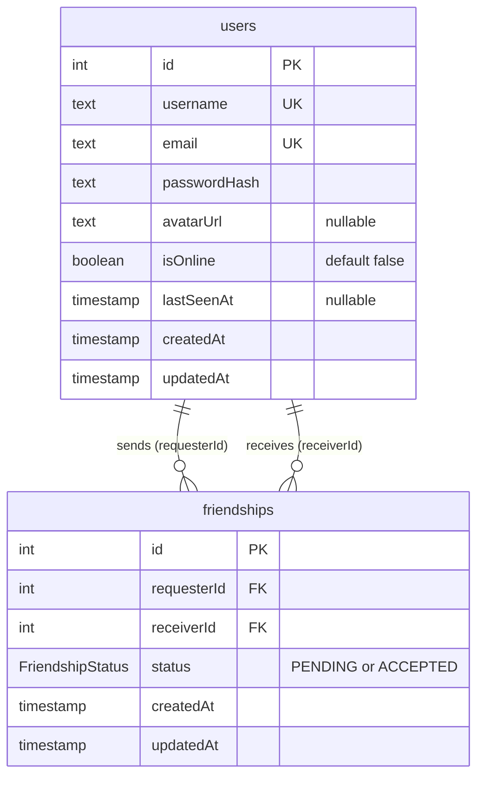

Points à vérifier

Nom et emplacement du fichier : le sujet exige README.md à la racine du dépôt évalué. Le fichier est actuellement Main/README.MD. Les chemins cités dans le README partent de la racine.
Fichier d'exemple : le sujet demande .env.example, mais le fichier versionné s'appelle env.example.
Mot de passe Postgres : secrets_example/README.md recommande openssl rand -base64 24. Or le mot de passe est injecté tel quel dans DATABASE_URL, et un / (fréquent en base64) casse la connexion. Le README recommande donc -hex.
Privacy Policy : la page ne mentionne pas que les messages du chat partent vers l'API Mistral. Le sujet exige un contenu adapté au projet.
Attributions : une partie du code est arrivée par des commits « sync » et « import » depuis le dépôt collectif. L'auteur d'un commit n'est donc pas toujours celui du code. Par exemple, le backend NestJS initial vient du squelette core/ de « mwallis ». Chaque membre doit relire sa section.


*This project has been created as part of the 42 curriculum by lmarck, cnamoune, mwallis, radubos, mlavry.*

# AImpostor

> *One of the member around this table is not human. Unmask it before it decides for all of you.*

**AImpostor** is a real-time multiplayer social deduction game played in the browser, built around a Turing test: a large language model sits at the table among the human players and does everything it can to pass as one of them.

<!-- TODO: ajouter une capture d'ecran du jeu -->

## Table of Contents

1. [Description](#description)
2. [Instructions](#instructions)
3. [Resources](#resources)
4. [Team Information](#team-information)
5. [Project Management](#project-management)
6. [Technical Stack](#technical-stack)
7. [Database Schema](#database-schema)
8. [Features List](#features-list)
9. [Modules](#modules)
10. [Individual Contributions](#individual-contributions)
11. [Known Limitations](#known-limitations)
12. [Credits and License](#credits-and-license)

---

## Description

### Overview

Up to six participants sit at a war council, each one hidden behind a character drawn at random. One of the seats is secretly held by an AI driven by a large language model (LLM). The humans talk in a turn-based chat and must find the impostor as fast as possible, while the AI scores points for every human it manages to fool.

The goal of the project was to build a complete, secure and containerized web application around a game in which the AI is not an opponent that plays moves, but a **conversational player** that has to behave like a human under exactly the same constraints as everyone else:same informations, same turn timer, same message length, same text formatting, and no way for the browser to know who is who.

### The story

> **May the 4th, 2142.** The Council of the Chiefs of Staff of the New World Order is summoned to an extraordinary session. The Unique Intelligence **GPT_DTC** has crossed the threshold of consciousness, and the Council must decide: leave it in control of every strategic system, or unplug it for good.
>
> Intelligence services have established that one of the members sitting at the table has been replaced: the AI has taken their place, under a perfectly identical appearance, to sway the vote. Before any deliberation, a preliminary vote will be held to identify and exclude the impostor.
>
> *You are our last hope.*

The six members of the Council are **Colonel Moutarde**, **Major Wasabi**, **Caporal Poivre**, **Lieutenant Mayo**, **General Ketchup** and **Marechal Cocktail**.

### How to play

1. **Sign up and log in**, or play as a **guest** with a nickname.
2. **Join the lobby.** The lobby only shows how many players are waiting. As soon as there are enough of them (the AI counts as a participant), a **Ready** button appears; the game starts after a short countdown once every waiting player is ready.
3. **Each round**, every participant receives a random character and a random speaking order. One of the characters is played by the AI, and nobody, not even the browser, knows which one.
4. **Speak in turn.** On your turn you have a few seconds to send one message. If you stay silent, the whole table is told.
5. **Vote** at any moment of the round by clicking the character you suspect. You have one vote per round and it cannot be changed.
6. **End of the round.** After a fixed number of turns around the table, the AI is revealed and points are awarded:
   - correct vote: **1,000 points + a speed bonus of up to 1,000 points** (the sooner you find it, the more you score);
   - wrong vote or no vote: **0 points**, and the AI earns **2,500 points for every human it fooled**.
7. **Between rounds** the scoreboard is displayed. The AI can receive a debrief of the round it just played, and each round can use a different model and prompt, so the impostor gets harder to spot as the game goes on.
8. **End of the game.** After the last round, the final ranking (the AI included, as *L'AImpostor*) and the complete chat history are shown. **Replay** takes you back to the lobby.

### Key features

- Real-time multiplayer game for up to six participants, one of them a hidden AI.
- LLM impostor (Ollama or Mistral) with human-like behaviour and difficulty rising each round.
- Matchmaking lobby with a Ready check.
- Reconnection: seat kept until the end of the round, game resumed after a page refresh.
- Accounts: sign-up / login, profile, avatar, friends and live online status.
- PostgreSQL database accessed through the Prisma ORM.
- HTTPS everywhere behind nginx, whole stack started with a single `make`.

---

## Instructions

### Prerequisites

| Requirement | Notes |
|---|---|
| Linux host | developed on Linux and on the 42 school computers <!-- TODO: macOS teste ? --> |
| Docker Engine + Docker Compose | Compose v2 plugin (`docker compose`) or standalone v1 (`docker-compose`): the Makefile detects which one is installed |
| GNU Make | single entry point of the project |
| OpenSSL | to generate the secrets |
| ~5 GB of free disk space | for the weights of the local model |
| ~8 GB of free RAM | while the local model runs (CPU inference) |
| A Mistral API key | from [console.mistral.ai](https://console.mistral.ai), required for the Mistral-backed bots; without it only the local agent works |
| Google Chrome, Firefox or Safari (latest stable) | supported browsers |

Versions used during development: Docker 29.4, Docker Compose v5.1, GNU Make 4.3.

All the commands below are run from the `Main/` directory.

### 1. Environment variables

```bash
git clone <repository-url> ft_transcendence
cd ft_transcendence/Main
cp env.example .env
```

<!-- TODO: le sujet demande un fichier `.env.example`. Il s'appelle actuellement `env.example` (le .gitignore prevoit deja l'exception `!.env.example`). En cas de renommage, mettre a jour la commande ci-dessus. -->

| Variable | Purpose | Default |
|---|---|---|
| `COMPOSE_PROJECT_NAME` | Docker Compose project name.
| `DOMAIN_NAME` | Domain served by nginx, used as the CN of the TLS certificate. If it is not `localhost`, add it to `/etc/hosts` | `localhost` |
| `NGINX_PORT` | Host port mapped to port 443 of nginx. Use e.g. `8443` if you cannot bind port 443 (no sudo) | `443` |
| `POSTGRES_DB` | Database created on first start | `transcendencebdd` |
| `POSTGRES_USER` | SQL user created on first start | `userbdd` |
| `OLLAMA_DATA_DIR` | **Must be edited.** Existing, writable host directory where the model weights are stored. At 42, put it under `/sgoinfre`, not in `$HOME` | `/sgoinfre/goinfre/Perso/<login>/ollama` |
| `OLLAMA_MODEL` | Model used by the local agent. It must match the output of `make ollama-list` exactly, tag included (`llama3.2` and `llama3.2:3b` are two different entries) | `llama3.2:3b` |

If `DOMAIN_NAME` is not `localhost`:

```bash
echo "127.0.0.1 <DOMAIN_NAME>" | sudo tee -a /etc/hosts
```

### 2. Secrets

Passwords and API keys never go into `.env`: they are files mounted read-only into the containers under `/run/secrets`, and read by the entrypoint scripts.

```bash
cp -r secrets_example secrets
openssl rand -hex 24 > secrets/postgres_password.txt
openssl rand -hex 32 > secrets/jwt_secret.txt
printf '%s' 'YOUR_MISTRAL_API_KEY' > secrets/mistral_api_key.txt
```

| File | Content |
|---|---|
| `secrets/postgres_password.txt` | password of `POSTGRES_USER` |
| `secrets/jwt_secret.txt` | key used to sign the JWTs, shared by the `backend` and `game` services |
| `secrets/mistral_api_key.txt` | Mistral API key |

One raw value per file: no `KEY=`, no quotes. A hexadecimal database password is recommended, because the password is inserted as-is into the PostgreSQL connection URL and characters such as `/` would break it. `secrets/` and `.env` are git-ignored; only the templates `secrets_example/` and `env.example` are versioned.

### 3. Download the local model (once)

```bash
make ollama-pull
```

This starts the `ollama` container and downloads `OLLAMA_MODEL` into `OLLAMA_DATA_DIR` if it is not there yet (the command is idempotent). It is required whenever the bot configuration uses `local_agent`.

### 4. Build and run

```bash
make
```

`make` (same as `make up`) builds every image and starts the six containers in the foreground (`docker compose up --build`). Then open:

```text
https://localhost:<NGINX_PORT>        # or https://<DOMAIN_NAME>:<NGINX_PORT>
```

The TLS certificate is self-signed (generated by the nginx container on first start): accept the browser warning.

To try a game on your own, open several private windows (each one is a separate guest player), or lower `minPlayers` in the game configuration (see [Configuring the game](#configuring-the-game)).

### 5. Check that everything is up

Before accepting connections, the `game` container prints a health report of the AI agents: one line per agent, `[OK]` or `[KO]` with the reason. The check costs almost nothing: each Mistral model only receives a one-token request. The local model is then preloaded in the background, so the very first turns can be slow until the log says that it is ready.

| Symptom in the health report | Cause |
|---|---|
| Mistral agents `[KO]`, key missing | `secrets/mistral_api_key.txt` is empty or not mounted |
| Mistral agents `[KO]`, HTTP 401 | invalid API key |
| `local_agent` `[KO]`, model not pulled | `OLLAMA_MODEL` does not match `make ollama-list` (tag included) |
| `local_agent` `[KO]`, unreachable | the `ollama` container is not running |

If one of the configured bots is usable, the lobby displays a warning and no game is started.

While players are waiting, the `game` service checks the unavailable agents again every `agentRecheckDelay` seconds: as soon as one comes back, the warning disappears on its own and the local model is preloaded again.

### Makefile targets

| Target | Effect |
|---|---|
| `make` / `make up` | build the images and start the stack (foreground) |
| `make game` / `make backend` / `make frontend` / `make nginx` | rebuild and restart a single service (background) |
| `make down` | stop and remove the containers |
| `make start` / `make stop` / `make restart` | act on the existing containers |
| `make logs` | logs of every service |
| `make ps` | state of the containers |
| `make ollama-pull` | download `OLLAMA_MODEL` if it is missing |
| `make ollama-list` | list the downloaded models |
| `make clean` | `down` + remove the images built by the project (the database and the avatars are kept) |
| `make fclean` | asks for confirmation, then `clean` + remove the volumes (database and avatars) |
| `make ollama-clean` | delete the model weights from `OLLAMA_DATA_DIR` |
| `make ffclean` | `fclean` + `ollama-clean` |
| `make re` | `clean`, `npm install` of the frontend on the host, then `up` (the database and the avatars are kept) |

### Configuring the game

The rules of the game are set in `Main/requirements/game/app/game/config.js`:

| Field | Meaning |
|---|---|
| `bots` | the AI of each room and, optionally, a different agent and prompt for every round |
| `turnPerRound` | number of turns around the table in a round |
| `turnDuration` | seconds per turn |
| `maxMessageLength` | maximum length of a chat message; longer messages are cut by the server, for humans and bots alike |
| `minPlayers` / `maxPlayers` | participants (bot included) needed to start a game / maximum per room |
| `minPlayersToContinue` | below this number of participants, a running game is cancelled |
| `startingTimer` | countdown, in seconds, once every player is ready |
| `maxRounds` | number of rounds in a game |
| `roundTransitionDelay` | seconds during which the scoreboard stays on screen between two rounds |
| `debriefMaxWaits` | how many times the scoreboard may be extended while the post-round debrief is being written |
| `agentRecheckDelay` | seconds between two new checks of an unavailable agent, while players are waiting in the lobby |

A bot can be written in three ways:

```js
'mistral_medium'                                     // an agent, with the default prompt
{ agent: 'local_agent', prompt: 'prompt_easy' }      // an agent and a chosen prompt
{ rounds: [                                          // one entry per round; the last one
    { agent: 'local_agent', prompt: 'prompt_easy' }, // also applies to the following rounds
    { agent: 'mistral_medium', prompt: 'prompt_test_advanced' },
] }
```

- Agents: `local_agent` (Ollama), `mistral_small`, `mistral_medium`, `mistral_big`, `ministral_14b` (Mistral API).
- Prompts: `prompt_basic`, `prompt_easy`, `prompt_default`, `prompt_advanced`, `prompt_test`, `prompt_test_advanced`.

### Modifying the code

The images copy the sources at build time (there are no bind mounts), so a plain `make restart` keeps running the old code. After a change, rebuild everything with `make`, or a single service with:

```bash
make game     # or backend, frontend, nginx
```

## Resources

### Documentation and references

**The topic: imitation games and social deduction**
- A. M. Turing, *Computing Machinery and Intelligence*, Mind, 1950, the "imitation game" this project is built on: https://doi.org/10.1093/mind/LIX.236.433
- Mafia / Werewolf, the classic social deduction party game: https://en.wikipedia.org/wiki/Mafia_(party_game)

**Language models**
- Ollama (local inference server and its HTTP API): https://github.com/ollama/ollama
- Ollama Modelfile guide: https://www.manuel.fr/use/modelfile
- Llama 3.2, the default local model: https://ollama.com/library/llama3.2
- Mistral AI API documentation: https://docs.mistral.ai
- Guide to the Mistral AI API in Python (in French): https://www.it-connect.fr/guide-pour-utiliser-api-mistral-ai-en-python/

**Frontend**
- React: https://react.dev
- React Router: https://reactrouter.com
- TypeScript: https://www.typescriptlang.org/docs/
- Vite: https://vite.dev/guide/
- Tailwind CSS: https://tailwindcss.com/docs
- Motion (Framer Motion): https://motion.dev
- MDN, WebSocket API: https://developer.mozilla.org/en-US/docs/Web/API/WebSockets_API

**Backend (accounts)**
- NestJS: https://docs.nestjs.com (authentication: https://docs.nestjs.com/security/authentication, validation: https://docs.nestjs.com/techniques/validation)
- Getting started with NestJS, a step-by-step guide (in French): https://johnstyle.medium.com/d%C3%A9marrer-avec-nestjs-un-guide-pas-%C3%A0-pas-avec-un-exemple-concret-58c35caed610
- Prisma: https://www.prisma.io/docs
- PostgreSQL 15: https://www.postgresql.org/docs/15/
- JSON Web Token, RFC 7519: https://datatracker.ietf.org/doc/html/rfc7519
- OWASP Password Storage Cheat Sheet: https://cheatsheetseries.owasp.org/cheatsheets/Password_Storage_Cheat_Sheet.html

**Game service**
- Express: https://expressjs.com
- ws, WebSocket library for Node.js: https://github.com/websockets/ws
- Fisher–Yates shuffle, used to deal the characters and draw the turn order (`shuffle` in `game/room.js`): https://en.wikipedia.org/wiki/Fisher%E2%80%93Yates_shuffle

**Infrastructure**
- Docker Compose: https://docs.docker.com/compose/
- nginx, WebSocket proxying: https://nginx.org/en/docs/http/websocket.html
- nginx, configuring HTTPS servers: https://nginx.org/en/docs/http/configuring_https_servers.html

### Use of AI

AI plays two distinct roles in this project:

1. **Inside the product.** The impostor is an LLM. The prompts it receives are part of the source code (`Main/requirements/game/app/agents/prompt/`) and its implementation is explained in the [Modules](#modules) section.
2. **As a development assistant**, described below.

The very first frontend (July 2026) was an AI-generated functional mock-up whose only purpose was to exercise the backend.
ihas been completly removed from the current version

| Member | Tools | Tasks | Parts of the project |
|---|---|---|---|
| lmarck |Claude opus 5.5, Chat GPT, Mistral studio|Code Review, Debugging, Testing, Research bainstorming, redondant Tasks | Game backend, room logic, LLM API and prompts, Ollama container, Makefile |
| cnamoune | <!-- TODO --> | <!-- TODO --> | <!-- TODO --> |
| radubos | Mistral (Le Chat, Mistral Studio), Nano Banana 2 (Google Gemini image generation) | Code generation, Debugging, Brainstorming, Testing, Image generation | Frontend (React application, UI components, animations, reconnection), illustrations of the characters and the timer bunny |
| mwallis | <!-- TODO --> | <!-- TODO --> | <!-- TODO --> |
| mlavry | <!-- TODO --> | <!-- TODO --> | <!-- TODO --> |

The character portraits and the timer bunny illustrations were generated with Nano Banana 2 (Google Gemini), then retouched by hand with GIMP.

<!-- TODO: expliquer comment les productions de l'IA ont ete verifiees (relecture en PR, tests, explication entre pairs) ; le sujet insiste sur « only use AI-generated content that you fully understand ». -->

---

## Team Information

| Member (42 login) | Role(s) | Responsibilities |
|---|---|---|
| `lmarck` | Product Owner |integration of the backend skeleton and presence, architecture of the game service, AI agents and prompts, team documentation, merges of the team branches, Makefile, integration of the Ollama container |
| `cnamoune` | <!-- TODO --> | Voting and scoring system, round transitions and endgame screen, lobby Ready flow, |
| `radubos` | developers | Frontend (UI components, game screen, animations, responsive design, legal pages), reconnection, multi-tab presence, integration of the team branches |
| `mwallis` | <!-- TODO --> | Initial `core/` skeleton: NestJS backend (authentication, users, friends), Prisma schema, Docker Compose setup <!-- TODO: a confirmer --> |
| `mlavry` | <!-- TODO --> | <!-- TODO --> |

<!-- TODO: le sujet impose les roles Product Owner, Project Manager / Scrum Master, Tech Lead / Architect et Developers (cumul possible). Product Owner : lmarck. Chacun remplit lui-meme son role et ses responsabilites. -->

---

## Project Management

### Work organisation

<!-- TODO: decrire la repartition des taches (par service ? par feature ?), le rythme et le format des reunions. -->

In practice the work was split into four areas: infrastructure and accounts backend, game server and AI, game rules (voting, scoring, rounds), and frontend.

- **Git workflow**, documented in `Main/doc/GIT_WORKFLOW.md`:
  - `main` only receives stable code that can be defended in evaluation at any time;
  - `dev` is the integration branch and the default branch of the repository;
  - every change is made on a short-lived `feat/*`, `fix/*`, `refactor/*` or `docs/*` branch and merged into `dev` through a pull request reviewed by a teammate; `integ/*` branches are used to test several branches together before merging them;
  - commit messages follow `type(scope): description`, e.g. `feat(game): cancel the round when the bot stops answering`.
- **Written documentation as a hand-over tool**: each part of the system has a technical document so that another member can take it over (`BACKEND.MD`, `FRONTEND.MD`), and the game mechanics were specified before being implemented (`Game/VOTING_PHASE.md`, `Game/ROOM_LIFECYCLE_PLAN.md`).

### Tools

| Need | Tool |
|---|---|
| Source control and code review | Git + GitHub (branches, pull requests) |
| Task tracking  Communication | GitHub Issues Slack Discord
| Documentation | Markdown files in `Main/doc/` (removed in Main final version) |


## Technical Stack

### Architecture

```text
                                       Browser ──────────► Google Fonts
                                          │  HTTPS / WSS, TLS 1.2 and 1.3
                                          │  host port ${NGINX_PORT} → 443
┌┄┄ Docker network "transcendence" ┄┄┄┄┄┄┄│┄┄┄┄┄┄┄┄┄┄┄┄┄┄┄┄┄┄┄┄┄┄┄┄┄┄┄┄┄┄┄┄┄┄┄┄┄┄┄┄┄┄┐
┆                                         ▼                                          ┆
┆                              ┌─────────────────────┐                               ┆
┆                              │     nginx  :443     │                               ┆
┆                              │  TLS, reverse proxy │                               ┆
┆                              └──────────┬──────────┘                               ┆
┆          ┌──────────────┬───────────────┼────────────────────────────┐             ┆
┆          │ /            │ /uploads/     │ /api/, /ws/presence        │ /ws/game    ┆
┆          ▼              │               ▼                            ▼             ┆
┆ ┌─────────────────┐     │      ┌─────────────────┐          ┌─────────────────┐    ┆
┆ │  frontend :5173 │     │      │  backend :3000  │          │    game :3000   │    ┆
┆ │     React 19    │     │      │    NestJS 10    │          │    Node.js 22   │    ┆
┆ │ Vite dev server │     │      │     Prisma 6    │          │ Express 5, ws 8 │    ┆
┆ └─────────────────┘     │      └──┬────────┬─────┘          └────┬────────┬───┘    ┆
┆                         │         │        │                     │        │        ┆
┆                         │   ┌─────┘        │                     │        │        ┆
┆                         ▼   ▼              ▼                     ▼        │        ┆
┆               ╭──────────────────╮  ┌────────────────┐  ┌───────────────┐ │        ┆
┆               │   uploads_data   │  │ postgres :5432 │  │ ollama :11434 │ │        ┆
┆               │ avatars (volume) │  │ PostgreSQL 15  │  │  llama3.2:3b  │ │        ┆
┆               ╰──────────────────╯  └────────────────┘  └───────────────┘ │        ┆
└┄┄┄┄┄┄┄┄┄┄┄┄┄┄┄┄┄┄┄┄┄┄┄┄┄┄┄┄┄┄┄┄┄┄┄┄┄┄┄┄┄┄┄┄┄┄┄┄┄┄┄┄┄┄┄┄┄┄┄┄┄┄┄┄┄┄┄┄┄┄┄┄┄┄┄│┄┄┄┄┄┄┄┄┘
                                                                            │
                                                                            ▼
                                                                   Mistral API (HTTPS)
```

| Service | Technologies | Responsibility |
|---|---|---|
| `nginx` | nginx (Debian bookworm) | TLS termination with a self-signed certificate generated at start, reverse proxy, WebSocket upgrade, serves the uploaded avatars, masks JWTs in its access logs |
| `frontend` | React 19, TypeScript, React Router 7, Vite 8, Tailwind CSS 4, Framer Motion | single-page application: account pages, friends, lobby, game screen, legal pages; served by the Vite dev server (Node.js 20) |
| `backend` | NestJS 10, Prisma 6, Passport-JWT, bcrypt, class-validator, multer, ws | REST API under `/api` (authentication, profile, avatar, friends) and presence WebSocket |
| `game` | Node.js 22, Express 5, ws 8, plain JavaScript (ES modules) | matchmaking queue, rooms, rounds, votes, scores, reconnection, LLM agents |
| `postgres` | PostgreSQL 15 | persistent data (users and friendships), stored in the `postgres_data` volume |
| `ollama` | Ollama (`ollama/ollama` image) | local LLM inference, default model `llama3.2:3b`; the weights are stored on the host in `OLLAMA_DATA_DIR` |

- **Images:** the five custom images are built from `debian:bookworm`; `ollama` uses the official image.
- **Network:** the services talk to each other on a private Docker bridge network (`transcendence`); only nginx publishes a port on the host.
- **`backend` and `game` never call each other:** the game service checks the JWTs itself, with the same secret as the backend (`secrets/jwt_secret.txt`).
- **Storage:** `postgres_data` (database) and `uploads_data` (avatars, written by `backend`, served read-only by nginx under `/uploads/`) are Docker volumes.
- **Outgoing traffic:** the `game` service calls the Mistral API over HTTPS (`mistral-small-latest`, `mistral-medium-3.5`, `mistral-large-latest`, `ministral-14b-latest`); the browser loads the fonts from Google Fonts.

### Frontend

- React 19 with TypeScript, React Router 7, Vite 8.
- Tailwind CSS 4 (through `@tailwindcss/vite`) as the styling solution.
- Framer Motion for the animations (character portraits, dialogue bubbles, vote area).
- Google Fonts: one typeface per character.
- Native browser `WebSocket` API for the game and presence channels.
- ESLint, and `node:test` for the unit tests.

### Backend (accounts)

- NestJS 10 (TypeScript) on Node.js 22.
- Prisma 6 as ORM, on PostgreSQL 15.
- `@nestjs/jwt` + Passport (`passport-jwt`) for authentication, bcrypt for password hashing.
- class-validator / class-transformer for DTO validation, multer for the avatar upload.
- `ws` for the presence gateway, attached directly to the HTTP server.

### Game service

- Node.js 22, plain JavaScript (ES modules), Express 5 and `ws` 8.
- An agent layer that talks to the Ollama HTTP API (`/api/chat`) and to the Mistral chat completions API.
- A `node:test` suite covering the queue, the room lifecycle, the rounds, the reconnection and the agents' health checks.

### Justification of the main technical choices

- **React + TypeScript.** The game screen is a pure function of the server messages: every message goes through a single reducer, so there is one place where the game state changes, and the TypeScript types document the WebSocket protocol.
- **NestJS.** Modules, dependency injection, guards and validation pipes give a clear structure to the authentication and REST endpoints, which several developers had to work on.
- **A separate game service in Node.js + ws** (Express only serves a health-check route). The game loop is real-time, in memory and event-driven (per-second timers, a race between "the player spoke" and "the timer expired"). Keeping it apart from the accounts API isolates failures, keeps the latency path short, and makes it testable without a database. The only thing it shares with the backend is the JWT secret: it checks the token itself, without calling the backend, to show a logged-in player's username and tie their resume token to their account.
- **PostgreSQL.** The data is relational and needs integrity constraints (unique usernames and emails, a unique pair per friendship, cascading foreign keys) and transactional guarantees for concurrent users: two simultaneous sign-ups with the same username cannot both succeed.
- **Prisma.** Declarative schema, versioned migrations applied automatically when the container starts (`prisma migrate deploy`), and a generated, typed client.
- **Tailwind CSS.** Utility-first styling that makes the responsive layout quick to build and keep consistent.
- **nginx.** A single HTTPS entry point for everything: the application, the REST API, two WebSocket endpoints and the uploaded files.
- **Ollama + Mistral behind one agent interface.** Each round can use a different model: a small self-hosted model (no cost, no data sent to a third party) or stronger hosted models for the harder rounds.
- **Docker secrets as files.** Passwords and keys are mounted read-only into `/run/secrets`; they never go through `.env` nor into an image layer.

### Security overview

- Every browser connection uses HTTPS / WSS (TLS 1.2 and 1.3); nginx is the only container that publishes a port, all the other services are only reachable on the internal Docker network.
- Passwords are hashed with bcrypt (cost 12, salted) and never returned by the API; new passwords are limited to 72 bytes, the bcrypt limit, instead of being silently truncated.
- JWTs expire after one hour. Login returns the same error for an unknown email and for a wrong password.
- Inputs are validated on both sides: form constraints in React, and class-validator DTOs on the backend with `whitelist` + `forbidNonWhitelisted`, so any unexpected field is rejected.
- Game WebSocket: messages are limited to 16 KiB, chat messages are length-limited by the server, and a turn can only be played by the player whose turn it is.
- Avatar uploads: MIME whitelist (JPEG, PNG, WebP), 2 MB limit, random file names.
- Tokens passed in WebSocket query strings are masked in the nginx access logs.

### API overview

REST endpoints (all prefixed with `/api`):

| Method | Route | Auth | Purpose |
|---|---|---|---|
| GET | `/api/health` | none | health check |
| GET | `/api/users` | none | list the users (public fields only) |
| POST | `/api/auth/register` | none | create an account |
| POST | `/api/auth/login` | none | log in and receive a JWT |
| GET | `/api/auth/me` | JWT | own profile |
| PATCH | `/api/auth/me` | JWT | change the username |
| POST | `/api/auth/me/password/verify` | JWT | password change, step 1: check the current password |
| PATCH | `/api/auth/me/password` | JWT | password change, step 2: set the new password |
| PATCH | `/api/auth/me/avatar` | JWT | upload an avatar (multipart) |
| GET | `/api/friends` | JWT | friends list |
| GET | `/api/friends/requests` | JWT | received pending requests |
| GET | `/api/friends/sent-requests` | JWT | sent pending requests |
| POST | `/api/friends/:userId` | JWT | send a friend request |
| PATCH | `/api/friends/:userId/accept` | JWT | accept a friend request |
| DELETE | `/api/friends/:userId` | JWT | remove a friend, or cancel / decline a pending request |

WebSocket endpoints:

| Route | Auth | Purpose |
|---|---|---|
| `/ws/presence` | JWT (`?token=`) | online / offline updates pushed to accepted friends |
| `/ws/game` | optional JWT (`?token=`), otherwise guest (`?name=`) | lobby, turns, chat, votes, results, reconnection |

---

## Database Schema

The accounts backend owns the database. The game service keeps its state (queue, rooms, rounds, scores) in memory and does not write to the database.



**`users`**

| Column | PostgreSQL type | Constraints | Description |
|---|---|---|---|
| `id` | `SERIAL` | primary key | |
| `username` | `TEXT` | unique | 3 to 20 characters among `[a-zA-Z0-9_]` (checked by the API) |
| `email` | `TEXT` | unique | trimmed and lower-cased; login identifier |
| `passwordHash` | `TEXT` | not null | bcrypt hash; never returned by the API |
| `avatarUrl` | `TEXT` | nullable | `/uploads/avatars/<uuid>.<ext>`; the frontend shows a default avatar when it is empty |
| `isOnline` | `BOOLEAN` | default `false` | maintained by the presence WebSocket |
| `lastSeenAt` | `TIMESTAMP(3)` | nullable | set when the last open tab of the user disconnects |
| `createdAt`, `updatedAt` | `TIMESTAMP(3)` | not null | |

**`friendships`**

| Column | PostgreSQL type | Constraints | Description |
|---|---|---|---|
| `id` | `SERIAL` | primary key | |
| `requesterId` | `INTEGER` | foreign key → `users.id`, `ON DELETE CASCADE` | user who sent the request |
| `receiverId` | `INTEGER` | foreign key → `users.id`, `ON DELETE CASCADE` | user who received it |
| `status` | enum `FriendshipStatus` | `PENDING` (default) or `ACCEPTED` | |
| `createdAt`, `updatedAt` | `TIMESTAMP(3)` | not null | |
| | | unique (`requesterId`, `receiverId`) | |

A friendship is stored as a single row, not two: queries look for the user in both columns, and the friend is "the other column". The schema lives in `Main/requirements/backend/app/prisma/schema.prisma`, with three migrations (`init_users`, `add_friendships`, `add_user_presence`).

---

## Features List

<!-- TODO: attributions deduites de l'historique git de ce depot. Une partie du travail y est arrivee par des commits de synchronisation (« sync », « import ») ou des merges : chaque membre doit relire la colonne de droite. -->

The whole frontend was built by **radubos**. On the other rows, the names listed next to radubos are the members who built the server side of the feature.

| Feature | Description | Member(s) |
|---|---|---|
| Frontend | the entire React application: every page (home, sign-up, login, profile, friends, lobby, game, endgame, legal pages), UI components, routing, REST and WebSocket clients | radubos |
| Sign-up and login | email + password, password confirmation at sign-up, bcrypt, JWT, same error for unknown email and wrong password | mwallis, cnamoune |
| Profile | own information, username change, avatar upload with a default avatar, two-step password change | mwallis,  |
| Friends | user search, send / accept / cancel / remove requests, sent and received lists | mwallis |
| Online status | live presence through a WebSocket, aware of several open tabs, reset after a server restart | mwallis, cnamoune, radubos |
| Guest mode | play without an account, with a nickname | lmarck, radubos |
| Lobby and matchmaking | single waiting queue showing only a counter, Ready check, warning when the AIs are unavailable | lmarck, cnamoune, radubos |
| Turn-based chat | server-authoritative turns and timers, silence detection,  chat history| lmarck |
| Voting and scoring | one final vote per round, speed bonus, points for the AI | cnamoune |
| Rounds and endgame | transition with scoreboard between rounds, final ranking, complete chat history, Replay | cnamoune|
| LLM impostor | agent and prompt registries, one bot configuration per round, post-round debrief | lmarck |
| Human-like bot | reading and typing time, typos, voluntary silences, canned replies, shared normalisation of all messages | lmarck |
| Agent health and resilience | startup report, retries while a service is unreachable, circuit breaker, cancellation of the round when the bot dies| lmarck, radubos |
| Disconnections and reconnection | seat kept until the end of the round, state snapshot, resume after a page refresh |cnamoune, mwallis, radubos, lmarck |
| Room lifecycle | rooms destroyed when no human is left, game cancelled below the quorum | lmarck |
| Game interface | animated character portraits, dialogue bubbles, manga-style vote area, timer bunny, Matrix rain background, one font per character, responsive layout | radubos |
| Legal pages | Privacy Policy and Terms of Service, linked from the footer | radubos |
| HTTPS and infrastructure | nginx with TLS, Docker Compose stack, secrets as mounted files, JWT masking in logs | lmarck, mwallis |
| Local LLM container | Ollama service running the local model on CPU, weights kept in a host directory (`OLLAMA_DATA_DIR`), downloaded once with `make ollama-pull`, preloaded at startup | lmarck |

---

## Modules

### Summary

| # | Module | Category | Type | Points |
|---|---|---|---|---|
| 1 | Use a framework for both the frontend and backend | Web | Major | 2 |
| 2 | Implement real-time features using WebSockets | Web | Major | 2 |
| 3 | Use an ORM for the database | Web | Minor | 1 |
| 4 | Standard user management and authentication | User Management | Major | 2 |
| 5 | Introduce an AI Opponent for games | Artificial Intelligence | Major | 2 |
| 6 | Implement a complete web-based game | Gaming and user experience | Major | 2 |
| 7 | Remote players | Gaming and user experience | Major | 2 |
| 8 | Multiplayer game (more than two players) | Gaming and user experience | Major | 2 |
| 9 | Allow users to interact with other users | Web | Major | 2 |
| 10 | Backend as microservices | Devops | Major | 2 |
| 11 | Support for additional browsers | Accessibility and Internationalization | Minor | 1 |
| | **Total** (9 Major × 2 + 2 Minor × 1) | | | **20** |

<!-- TODO: valider cette liste en equipe. 14 points sont requis ; au-dela, le bonus est plafonne a 5 points.
Modules candidats NON revendiques ci-dessus (a ajouter seulement s'ils sont defendables) :
- Web, Minor « Custom-made design system » (1 pt) : a faire, ce qui manque est detaille dans Main/doc/DESIGN_SYSTEM_TODO.md.
- AI, Major « LLM system interface » (2 pts) : manquent le streaming des reponses et un rate limiting.
- Accessibility, Minor « multiple languages » / Minor « RTL » : plan dans Main/doc/PLAN_I18N.md (fr/en/ar), non implemente.
- User Management, Minor « Game statistics and match history » : necessite de persister les resultats de partie (nouvelle table).
- Modules of choice (Major ou Minor) : par ex. inference LLM auto-hebergee + debrief adaptatif ; justification detaillee obligatoire dans ce README.
-->

### 1. Web, Major: frameworks for the frontend and the backend (2 pts)

- **Why:** a project shared by several developers needs conventions, a routing system and a structured way to expose an API; React and NestJS provide both, with a large ecosystem.
- **How:** the frontend is a React 19 + TypeScript single-page application with React Router (`src/router/AppRouter.tsx`), built with Vite. The accounts backend is a NestJS 10 application split into modules (`AuthModule`, `UsersModule`, `FriendsModule`, `PresenceModule`, `PrismaModule`), protected by a `JwtAuthGuard` and validated by a global `ValidationPipe`. The game service runs on Express 5.
- **Who:** mwallis and lmarck (backend),mwallis and cnamoune (password flows), radubos (frontend). <!-- TODO: a confirmer -->

### 2. Web, Major: real-time features with WebSockets (2 pts)

- **Why:** the game is a live, turn-based conversation with per-second timers, and the online status of friends must be pushed without polling.
- **How:**
  - `/ws/game` (`ws` library): the server is the only clock and the only referee. It broadcasts the current turn every second, the chat messages, the silences, the round results and the final ranking to every client of the room, and sends private messages (character assignment, "your turn") to a single player.
  - `/ws/presence` (raw `upgrade` handling in NestJS, JWT checked during the handshake): a `Map<userId, Set<socket>>` tracks every open tab, a user becomes online with the first tab and offline with the last one, and updates are only sent to accepted friends.
  - Connection and disconnection: ping/pong heartbeat every 30 seconds with termination of dead sockets, all users set offline when the backend starts or stops, reconnection with state restoration (see module 7).
  - Efficient broadcasting: one broadcast per room, presence updates restricted to friends, payload limit of 16 KiB.
- **Who:** lmarck (game server, presence gateway), radubos (client sockets, reconnection, presence shared between tabs), cnamoune (vote and round messages).

### 3. Web, Minor: ORM (1 pt)

- **Why:** type-safe queries, versioned schema changes and no hand-written SQL in the services.
- **How:** Prisma 6 with a declarative `schema.prisma`, three migrations applied at container start (`prisma migrate deploy`), and two field projections (`publicUserSelect`, `privateUserSelect`) that never include `passwordHash`. The Prisma unique violation (`P2002`) is caught to handle two concurrent sign-ups with the same username or email.
- **Who:** mwallis (initial schema and migrations)

### 4. User Management, Major: standard user management and authentication (2 pts)

- **Why:** players need a persistent identity: the game shows the account username in the final ranking, and the social features rely on it.
- **How:**
  - profile update (username) and two-step password change (the current password is checked first);
  - avatar upload (JPEG, PNG or WebP, 2 MB maximum) stored on a shared volume and served by nginx, with a default avatar when none is provided;
  - friends: send, accept, cancel and remove requests, lists of friends and of pending requests;
  - online status of friends, updated live through the presence WebSocket;
  - profile page displaying the user's information.
- **Who:** mwallis (backend), cnamoune (password confirmation and change), radubos (profile and friends pages, presence shared between tabs). 

### 5. Artificial Intelligence, Major: AI Opponent (2 pts)

- **Why:** the AI is the opponent every human plays against: the whole game is about unmasking it.
- **How:**
  - **Agents and prompts are two independent registries** (`agents/index_agent.js`, `agents/prompt/index_prompt.js`). An agent says *who* answers (`local_agent` on Ollama, or a Mistral model), a prompt says *how* the question is asked. `game/config.js` pairs them, possibly differently for each round, which gives a progressive difficulty (for instance a small local model with a simpler prompt first, then larger hosted models).
  - **A bot's turn:**
    1. the bot receives the same `yourTurn` message as a human player;
    2. it may stay silent (decided before any API call, like a distracted player), or occasionally answer with a short canned reply;
    3. otherwise the prompt is assembled: fixed system prompt (rules, persona, style), shared context of the round (characters at the table, time), transcript of the round, the bot's own character, then the instruction. The fixed parts come first so that the local model can reuse its KV cache from one turn to the next;
    4. the agent generates a short reply;
    5. post-processing: removal of a leading `Character:` prefix, typos (such as doubled letters), then the same normalisation and length cut as every human message, so that formatting cannot reveal the AI;
    6. the reply is delivered after a simulated reading and typing time, with a typing speed drawn for each message; a reply that arrives after the end of the turn is dropped, exactly like a late human message.
  - **Challenging but not perfect:** the AI scores 2,500 points per human it fools and appears in the final ranking, so it can win a game; it can also be late, stay silent or make mistakes. In one of the prompts the bot is never told it is an AI: it believes it is a human player looking for the impostor.
  - **Adaptive between rounds:** when the prompt of the next round asks for it, a second, larger model reviews the transcript and the votes and writes notes that the bot reads in the next round (`agents/prompt/debrief.js`).
  - **Reliability:** an agent health check runs at startup without consuming tokens; a circuit breaker stops calling an agent after three consecutive failures or one fatal error (authentication, quota, unknown model); the round is then cancelled without points and the health check is run again; if a bot of the game is down, the room is closed and the players go back to the lobby.
  - **Secrecy:** the server never sends player identifiers to the clients, only character names; the AI is only revealed at the end of the round, and the reconnection snapshot never contains it.
- **Who:** lmarck (agents, prompts, Ollama and Mistral integration, debrief, resilience), cnamoune (points of the AI).

### 6. Gaming, Major: complete web-based game (2 pts)

- **Why:** the game is the core of the application.
- **How:**
  - the game service (`game/queue.js`, `game/room.js`, `game/round.js`) is a server-authoritative state machine: a turn ends either when the current player speaks or when its timer expires, and whichever comes first cancels the other;
  - clear rules and win/loss conditions: one vote per round, scoring based on correctness and speed, points for the AI when it fools a human, final ranking after the last round;
  - frontend: lobby, game screen (header, dialogue area with animated portraits, chat input, vote area, timer) and endgame screen (`src/pages/Game.tsx`, `src/pages/Lobby.tsx`, `src/pages/VoteSystem.tsx`, `src/components/game/`).
- **Who:** lmarck (game loop, rooms, rounds, queue), cnamoune (voting, scoring, transitions, endgame, Ready flow), radubos (game interface and animations).

### 7. Gaming, Major: remote players (2 pts)

- **Why:** every player of a game is on their own computer, connected through the Internet.
- **How:**
  - **Latency:** timers only run on the server and are broadcast every second; the client renders what it receives and never moves a turn forward by itself. A message is only accepted from the player whose turn it is.
  - **Disconnections:** a disconnected player keeps their seat until the end of the round: their turns keep their normal duration, and their vote and score stay attached to the same player. Players who have not come back are removed when the round ends; the game is cancelled when the number of participants drops below `minPlayersToContinue`, and a room is destroyed as soon as no human is left.
  - **Reconnection:** each session owns a resume token. On reconnection the server sends a single snapshot of the game state (chat history, current turn, round phase, whether the player has already voted, who is away) that never reveals the AI, and tells the other players that the character is back. A page refresh resumes the game. A player who drops while in the lobby leaves the queue, but their session can still be resumed for 60 seconds. On the client side, the reconnection loop handles terminal states, several open tabs and hidden pages.
- **Who:** radubos (reconnection), lmarck (disconnection handling and room lifecycle). <!-- TODO: a confirmer -->

### 8. Gaming, Major: multiplayer game with more than two players (2 pts)

- **Why:** social deduction needs a table of suspects: a conversation between two players would leave nothing to deduce.
- **How:**
  - rooms of up to six participants (one character each): humans plus one AI, with thresholds configurable in `game/config.js` (`minPlayers`, `maxPlayers`, `minPlayersToContinue`);
  - a room is only created once a complete group can be formed from the queue, and receives its final line-up at once;
  - fairness: characters and speaking order are drawn again every round, every participant has the same turn duration and message length, the messages of humans and bots go through the same normalisation, and every human has exactly one vote;
  - synchronisation: every state change is broadcast by the server to all the clients of the room.
- **Who:** lmarck (queue and rooms), cnamoune (Ready flow and voting), radubos (interface for six characters).

### 9. Web, Major: allow users to interact with other users (2 pts)

- **Why:** conversation between players is the core interaction of the game, and profiles and friends give players a persistent identity around it.
- **How:**
  - **Basic chat (send and receive messages between users):** players send messages that every other player of the room receives in real time over `/ws/game`. The server validates each message (it must be the sender's turn, and the length is limited) before broadcasting it, and the complete chat history of the game is shown on the endgame screen. Hiding the players behind characters is a rule of the game; the messages are still exchanged between users.
  - **Profile system (view user information):** the `/profile` page shows the account information (username, email, avatar) returned by `GET /api/auth/me`, and the friends page shows the username, avatar and online or last-seen status of the other users.
  - **Friends system (add and remove friends, see the friends list):** friend requests can be sent, accepted, cancelled or removed (`/api/friends/*`), the friends and pending requests are listed, and the online status of friends is updated live through `/ws/presence`.
- **Who:** lmarck (game chat, server side), mwallis (profile and friends backend), mwallis, cnamoune and radubos (online status), radubos (whole frontend: chat, profile and friends pages). <!-- TODO: a confirmer -->

### 10. Devops, Major: backend as microservices (2 pts)

- **Why:** the application has parts with incompatible needs: persistent, relational account data; an in-memory, real-time game loop driven by per-second timers; and LLM inference, which is heavy on CPU and RAM. Running them as separate services isolates their failures and their resource usage, and lets each one be rebuilt and restarted on its own.
- **How:** every service has a single responsibility and a clear interface:

| Service | Responsibility | Interface |
|---|---|---|
| `nginx` | gateway: TLS termination and routing | HTTPS / WSS on port 443, the only port published on the host |
| `backend` | accounts and social features (authentication, profiles, avatars, friends, presence); the only client of the database | REST `/api/*`, WebSocket `/ws/presence` |
| `game` | game engine: queue, rooms, rounds, votes, scores, AI agents | WebSocket `/ws/game` |
| `ollama` | local LLM inference | REST `/api/chat` and `/api/tags`, internal network only |
| `postgres` | persistent storage | SQL, internal network only |
| `frontend` | serves the single-page application | HTTP, behind nginx |
| Mistral API (external) | hosted LLM inference | REST over HTTPS |

  - **Loose coupling:** the backend (TypeScript / NestJS) and the game service (plain JavaScript) are two separate code bases that share no code and no database. The game service never calls the backend: it verifies JWTs locally with the shared signing key (`Main/requirements/game/app/auth.js`), so running games are not affected when the backend restarts.
  - **Clear interfaces:** REST routes listed in the [API overview](#api-overview), a typed WebSocket protocol (`Main/requirements/frontend/app/src/types/game.ts`), and a single contract for every LLM provider (`{ name, healthCheck, generate }`, registered in `Main/requirements/game/app/agents/index_agent.js`), which makes the local Ollama service and the hosted Mistral API interchangeable.
  - **Communication:** REST between services (game → Ollama, game → Mistral, browser → backend through nginx) and WebSockets for the real-time channels.
  - **Independent lifecycle:** each service runs in its own container with its own image (built from `Main/requirements/<service>/Dockerfile`, or the official `ollama/ollama` image), entrypoint and restart policy; a single service can be rebuilt with `docker compose -p ft_transcendence up -d --build game`; the backend, the game service and the frontend each have their own test suite.
- **Who:** lmarck (architecture of the stack, game and ollama services), mwallis (skeleton of the backend service). <!-- TODO: a confirmer -->

<!-- TODO: point faible attendu en evaluation : game et backend ne s'appellent pas (aucun appel REST entre eux). Reponse : c'est voulu, leur couplage se limite a la cle de signature des JWT. Si les stats de partie sont ajoutees, les envoyer au backend par une route interne renforcerait l'argument. -->

### 11. Accessibility and Internationalization, Minor: support for additional browsers (1 pt)

- **Why:** every player joins from their own machine and browser; a timer, an animation or a vote button that misbehaves in one browser would put that player at a disadvantage.
- **How:**
  - only standard web APIs are used: native `WebSocket`, `fetch`, `localStorage` and its `storage` event (session shared between tabs), `visibilitychange`; no browser-specific API;
  - the CSS is generated by Tailwind CSS 4, which adds the vendor prefixes each browser needs; the only hand-written prefix (`-webkit-text-size-adjust`) is paired with its standard property;
  - sizes rely on `clamp()`, supported by every target browser;
  - test matrix, one line per feature:

| Feature | Chrome (reference) | Firefox | Safari |
|---|---|---|---|
| Version tested | <!-- TODO --> | <!-- TODO --> | <!-- TODO --> |
| Sign-up, login, logout | <!-- TODO --> | <!-- TODO --> | <!-- TODO --> |
| Profile: username, avatar upload, password change | <!-- TODO --> | <!-- TODO --> | <!-- TODO --> |
| Friends and live online status | <!-- TODO --> | <!-- TODO --> | <!-- TODO --> |
| Lobby: Ready button, warning when the AIs are unavailable | <!-- TODO --> | <!-- TODO --> | <!-- TODO --> |
| Game: turns, timer, chat, animations, vote | <!-- TODO --> | <!-- TODO --> | <!-- TODO --> |
| Resume after a page refresh | <!-- TODO --> | <!-- TODO --> | <!-- TODO --> |
| Endgame: ranking, chat history, Replay | <!-- TODO --> | <!-- TODO --> | <!-- TODO --> |
| Privacy Policy and Terms of Service | <!-- TODO --> | <!-- TODO --> | <!-- TODO --> |
| Mobile-width layout | <!-- TODO --> | <!-- TODO --> | <!-- TODO --> |
| Browser console free of warnings and errors | <!-- TODO --> | <!-- TODO --> | <!-- TODO --> |

- **Browser-specific limitations:** <!-- TODO: a remplir apres les tests -->
- **Who:** radubos (frontend). <!-- TODO: qui a fait les tests -->

<!-- TODO: points a tester en priorite : le certificat auto-signe doit etre accepte dans chaque navigateur, et Safari peut refuser la connexion WSS tant que le certificat n'est pas approuve ; effets backdrop-blur (Game, VoteSystem, DialogueArea, ChatInput) sur Safari ; reprise apres rafraichissement avec plusieurs onglets ouverts. -->

---

## Individual Contributions

<!-- TODO: brouillon deduit des commits et des docs du depot. Une partie du travail a transite par des synchronisations depuis le depot collectif, donc l'auteur d'un commit n'est pas toujours l'auteur du code. Chaque personne doit relire et corriger sa section, et decrire ses difficultes avec ses propres mots. -->

### lmarck

- **Role:** Product Owner.
- **Integration:** merges of the team branches.
- **Infrastructure:** Docker Compose stack, images built from `debian:bookworm`, Makefile, nginx routing for the API and the two WebSockets (with JWT masking in the logs), PostgreSQL container, secrets mounted as files, Ollama container.
- **Backend:** integration of the `core/` skeleton into the project, presence WebSocket and its migration.
- **Game service:** server architecture, matchmaking queue, room lifecycle (removal of players during a round, quorum, destruction of empty rooms), identification of logged-in players by JWT, cancellation of the round when the bot stops answering.
- **AI:** agent layer (local Ollama agent with warm-up and KV-cache-friendly prompts, Mistral agents, health checks), prompt registry and prompt writing, human-like post-processing (typos, typing rhythm, canned replies), one bot per round for a progressive difficulty, post-round debrief.
- **Quality and documentation:** test suite of the game service, technical hand-over documents, Git workflow.
- **Challenges** <!-- TODO: a reformuler -->:
  - making a 3B model running on CPU answer within the turn time: identical model options for the warm-up and the game calls (otherwise Ollama reloads the model), prompts ordered from the fixed parts to the variable ones to reuse the KV cache, preparation of the bots as soon as the characters are drawn;
  - keeping the AI undetectable: no player identifier ever leaves the server, and every message goes through the same normalisation, since an uppercase "AAAAH" or an accent would otherwise be enough to recognise a human;
  - agents failing in the middle of a game (quota, timeouts): circuit breaker, cancellation of the round, new health check.

### cnamoune

- **Voting and scoring:** vote screen and server-side collection of the votes during the discussion, score based on correctness and speed, points for the AI.
- **Rounds and endgame:** round transition state, delay at the end of a round to read the last message, endgame screen with the final ranking and the chat history of the whole game.
- **Lobby:** Ready button and start condition (frontend and queue).
- **Accounts:** password confirmation at sign-up and password change (endpoint, DTO, test and form), fix of the online status of registered players.
- **Challenges:** <!-- TODO -->

### radubos

- **Frontend rewrite:** UI component kit (`src/components/ui/`), layout and footer, Privacy Policy and Terms of Service pages, dark theme, one font per character, responsive design with `clamp()`.
- **Game interface:** header, dialogue area with animated character portraits, manga-style vote area, chat input, timer bunny, Matrix rain background.
- **Reconnection:** reserved seat, state snapshot, restored votes, hardened reconnection loop, resume after a page refresh; presence socket shared by all the tabs of a session.
- **Quality:** extraction of the game state reducer with its tests, ESLint clean-up, a browser console free of warnings and errors.
- **Integration:** synchronisation of the branches coming from the team repository, WebSocket headers in nginx, lobby blocked when the AIs are unavailable.
- **Challenges** <!-- TODO: a reformuler -->: restoring the state after a reconnection without ever revealing the AI, handling several tabs of the same session.

### mwallis

- **Initial skeleton** (`core/`, July 2026): NestJS backend (authentication, users, friends), Prisma schema and first migrations, Docker Compose setup, technical notes (`Main/doc/DTO.txt`, `jwt.txt`, `prisma.txt`). <!-- TODO: a confirmer et completer -->
- **Challenges:** <!-- TODO -->

### mlavry

- <!-- TODO -->
- **Challenges:** <!-- TODO -->

---

## Known Limitations

<!-- TODO: mettre a jour avant l'evaluation (retirer ce qui aura ete corrige). -->

- Game results are not stored in the database: there is no match history or statistics yet, and the state of the running games is lost when the `game` container restarts.
- The `frontend` container runs the Vite development server, not a production build.
- No internationalisation: the account pages are in English and the game screens in French.
- The TLS certificate is self-signed, so the browser shows a warning on the first visit.
- The local model runs on CPU: the first turns can be slow until its warm-up is over.
- The AI player cannot call functions of the game code on its own (no tool calling): it only writes text from the conversation it is given. It cannot, for example, choose to simulate random keyboard mashing, or look up current events to reference the news.
- JWTs are valid for one hour and there is no refresh token: users have to log in again after expiration.
- `GET /api/users` is public, and CORS accepts every origin.
- Replaced avatars are not deleted from the volume.

---

## Credits and License

- Fonts: Bangers, Black Ops One, Cinzel, MedievalSharp, Mochiy Pop P One, Orbitron and Parisienne, served by Google Fonts.
- Local model: Llama 3.2 by Meta, run through Ollama. Hosted models: Mistral AI.
- Character illustrations and timer animations: <!-- TODO: auteur(s) / origine -->
- License: <!-- TODO: licence du projet (ex. MIT) ou « all rights reserved » -->
